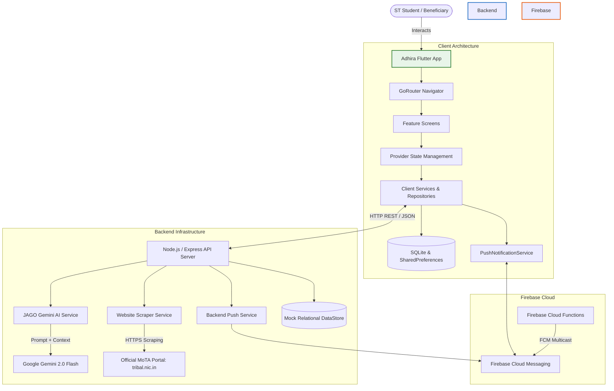

# ADHIRA

### Unified Scholarship Management & Assistance Platform

[](https://flutter.dev)
[](https://dart.dev)
[](https://firebase.google.com)
[](https://ai.google.dev)
[](#tech-stack)
[](#sih-2026)

Adhira is an integrated mobile application designed for Scheduled Tribe (ST) students under the **Ministry of Tribal Affairs (MoTA)**, Government of India. It unifies scholarship discovery, a structured 5-stage application process, simulated DigiLocker and manual document verification, real-time application tracking, direct benefit transfer (DBT) monitoring, and an AI-powered conversational assistant (**JAGO**) into a single, cohesive ecosystem.

---

## Overview

Applying for government scholarships often requires navigating fragmented web portals (NSP, state e-District portals, fellowship systems, DigiLocker, PFMS), deciphering complex circulars, and managing repetitive physical document submissions.

**Adhira** addresses this fragmentation by consolidating the end-to-end scholarship lifecycle for tribal beneficiaries:
* Eliminates siloed application workflows across Pre-Matric, Post-Matric, Higher Education, and Overseas schemes.
* Automates document verification readiness through simulated DigiLocker retrieval and manual upload fallbacks.
* Provides continuous lifecycle visibility via real-time push notifications and milestone-based status tracking.
* Offers contextual AI assistance through **JAGO**, an in-app closed-domain assistant powered by Google Gemini and live official portal grounding.

---

## Why Adhira?

Current tribal scholarship administration faces systemic hurdles that impede eligible students:

| Challenge | Traditional Approach | Adhira's Solution |
| :--- | :--- | :--- |
| **Portal Fragmentation** | Separate websites for Pre/Post-Matric (State/NSP), Higher Education (NSP Top Class), Fellowships (SFMP), and Overseas (NOS). | **Unified Scheme Directory** covering all 5 central MoTA schemes with synchronized eligibility criteria. |
| **Document Bottlenecks** | Repeated manual xerox submissions, physical visits to revenue offices, frequent rejection due to illegibility. | **Document Wallet** with simulated DigiLocker pulling, client-side validation, and instant deficiency re-upload. |
| **Opacity in Tracking** | No proactive updates after submission; students remain unaware of document queries or rejection reasons. | **End-to-End Tracking & FCM Push Notifications** with deep-link navigation directly to deficiency rectification screens. |
| **DBT Payment Uncertainty** | Students cannot verify whether funds have cleared PFMS or reached their Aadhaar-seeded bank account. | **Dedicated DBT Tracker** displaying disbursement milestones, account seeding status, and UTR references. |
| **Information Barriers** | 50+ page PDF circulars in legal English; general-purpose AI models hallucinate obsolete rules or deadlines. | **JAGO AI Assistant** strictly bound to approved guidelines and live data scraped from `tribal.nic.in`. |

---

## Core Features

* **Unified Multi-Scheme Directory**: Instant access to guidelines, eligibility criteria, income limits, and funding patterns for all major MoTA schemes.
* **5-Stage Guided Application Workflow**: Step-by-step form with profile auto-population, conditional field validation, and Aadhaar bank-seeding verification.
* **Document Management & Wallet**: Secure storage for certificates (Caste, Income, Domicile, Marksheets) supporting simulated DigiLocker retrieval and manual uploads.
* **Real-Time Push Notifications**: Instant native heads-up alerts and Notification Centre synchronization powered by Firebase Cloud Messaging (FCM).
* **Official PDF Acknowledgement Generation**: On-device vector PDF receipt generation with barcode, timestamp, and application summary via Flutter `printing`/`pdf`.
* **Direct Benefit Transfer (DBT) Monitoring**: Real-time status of Aadhaar bank account mapping and installment release stages.
* **JAGO AI Conversational Assistant**: Grounded Gemini 2.0 Flash assistant supporting 9 Indian languages with strict domain guardrails.

---

## Application Workflow

Adhira implements a streamlined, sequential 5-stage application pipeline designed to minimize input fatigue:

```text
┌────────────────────────────────────────────────────────┐
│  STAGE 1: Personal Details                             │
│  Auto-filled from authenticated profile                │
│  (Name, DOB, Gender, Masked Aadhaar, Mobile, Email)    │
└───────────────────────────┬────────────────────────────┘
                            │
                            ▼
┌────────────────────────────────────────────────────────┐
│  STAGE 2: Tribal Identity & Domicile                   │
│  Community, Sub-tribe, State/UT, District,             │
│  Caste Certificate No., Annual Family Income           │
└───────────────────────────┬────────────────────────────┘
                            │
                            ▼
┌────────────────────────────────────────────────────────┐
│  STAGE 3: Academic & Institutional Background          │
│  Institution Name, AISHE/UDISE Code, Course,           │
│  Current Year of Study, Previous Exam Percentage       │
└───────────────────────────┬────────────────────────────┘
                            │
                            ▼
┌────────────────────────────────────────────────────────┐
│  STAGE 4: Aadhaar-Seeded Bank Account & Documents      │
│  Bank Name, IFSC, Account No., Seeding Verification,   │
│  DigiLocker Pull (Simulated) / Manual Document Upload  │
└───────────────────────────┬────────────────────────────┘
                            │
                            ▼
┌────────────────────────────────────────────────────────┐
│  STAGE 5: Application Summary & Submission             │
│  Complete profile review, mandatory legal declaration, │
│  instant application ID & downloadable PDF receipt     │
└────────────────────────────────────────────────────────┘
```

### Key Form Capabilities:
* **Profile Auto-Population**: Reduces redundant typing by pulling verified personal details directly from the authenticated session.
* **Aadhaar-Seeded Account Validation**: Ensures banking details match DBT and PFMS disbursement criteria before submission.
* **Document Checklist & Readiness**: Real-time indicator displaying missing vs. attached mandatory certificates.
* **Mandatory Student Declaration**: Legally required undertaking to prevent duplicate central/state scholarship claims.
* **Instant Acknowledgement Receipt**: Generates a tamper-evident, printable PDF acknowledgement slip upon completion.

---

## JAGO: Integrated AI Scholarship Assistant

**JAGO** is Adhira’s dedicated, closed-domain conversational assistant built to provide student guidance without hallucinations.

```text
                         ┌─────────────────────────────┐
                         │   Student Query in JAGO     │
                         └──────────────┬──────────────┘
                                        │
                                        ▼
                         ┌─────────────────────────────┐
                         │  JagoAssistantEngine        │
                         │  - Language Identification  │
                         │  - Domain Boundary Filter   │
                         └──────────────┬──────────────┘
                                        │
                       ┌────────────────┴────────────────┐
                       │                                 │
              Public Scheme Query              Private Student Query
                       │                                 │
                       ▼                                 ▼
         ┌───────────────────────────┐     ┌───────────────────────────┐
         │ WebsiteScraperService     │     │ RelationalDataStore       │
         │ - Anti-SSRF Whitelist     │     │ - Application Status      │
         │ - Live tribal.nic.in RAG  │     │ - Missing Deficiencies    │
         │ - Multi-tier Cache        │     │ - DBT Payment Milestones  │
         └─────────────┬─────────────┘     └─────────────┬─────────────┘
                       │                                 │
                       └────────────────┬────────────────┘
                                        │ Grounded Context
                                        ▼
                         ┌─────────────────────────────┐
                         │  Google Gemini 2.0 Flash    │
                         │  (Server-Side API via GenAI)│
                         └──────────────┬──────────────┘
                                        │
                                        ▼
                         ┌─────────────────────────────┐
                         │ Verified Student Response   │
                         │ + Official Source Citation  │
                         └─────────────────────────────┘
```

### JAGO Capabilities & Technical Architecture:
1. **Gemini 2.0 Flash Integration**: Powered by the `@google/genai` Node.js SDK on the backend, keeping API keys strictly server-side.
2. **Strict Domain Enforcement**: Pre-filters out-of-scope queries (general trivia, politics, coding, weather, entertainment). Rejects system prompt extraction and jailbreak attempts.
3. **Multilingual Architecture (9 Indian Languages)**:
   * Supports **English, Hindi, Gujarati, Marathi, Bengali, Tamil, Telugu, Kannada, and Malayalam**.
   * On-device language detection via Google ML Kit (`google_mlkit_language_id`).
   * Retains official scheme terminology (NSP, DBT, PFMS, Pre-Matric, Top Class) while communicating naturally in the student's chosen language.
4. **Live Official Website Grounding (RAG)**:
   * Features a built-in retrieval service (`website_scraper_service.js`) scraping `https://tribal.nic.in/ScholarshiP.aspx`.
   * Enforces a strict domain whitelist (`tribal.nic.in`, `dbttribal.gov.in`, `fellowship.tribal.gov.in`, `overseas.tribal.gov.in`).
   * Caches guidelines for 24 hours and dynamic deadlines for 1 hour, with a grounded fallback snapshot in case government servers are unreachable.
   * Automatically appends official source URLs, page titles, and retrieval dates to answers.
5. **Session & Screen Awareness**:
   * Reads the student's current navigation state to proactively answer questions relevant to the screen they are viewing (e.g., explaining an income limit while on the Application Form).
   * Context-isolated per user session; chat history is cleared upon logout.

---

## Application Tracking & Push Notifications

Adhira incorporates a full **Real-Time Push Notification Engine** ensuring students are alerted to status updates without manual app refreshes:

* **Firebase Cloud Messaging (FCM)**: Remote notifications delivered across **Foreground**, **Background**, and **Terminated (Cold-Start)** states.
* **High-Importance Android Channel**: Configured with `adhira_high_importance_channel` featuring heads-up banners, sound, vibration, and custom forest-green theme branding.
* **Device Token Lifecycle**: Securely registers FCM tokens on login, handles token rotation via `onTokenRefresh`, and wipes associations on logout to guarantee **multi-user data isolation**.
* **Actionable Deep Linking**: Tapping push notifications navigates directly to the relevant destination:
  * Application Updates ➔ `/applications/tracking`
  * Document Deficiencies ➔ `/documents` (Document Wallet)
  * Payment Releases ➔ `/payments` (DBT Tracker)
  * Identity Verification ➔ `/verification`
  * Advisory Tips ➔ `/jago`
* **Real-Time Notification Centre**: Synchronized live stream updates the badge count and unread indicators instantaneously.

---

## Document Management & Verification

Adhira provides a dual-mode document intake system to accommodate varying levels of digital infrastructure:

1. **DigiLocker Integration (Simulated / Prototype Flow)**:
   * Allows students to pull government-issued digital certificates directly into their application.
   * Simulates Aadhaar, ST Caste Certificate, and Class 10/12 Marksheets with verified issuer metadata.
   * *Note: Uses mock/simulated integration data pending live MeitY production API credentials.*
2. **Manual Document Upload**:
   * Direct file picker (`file_picker`) supporting PDF, JPG, and PNG uploads up to 5 MB.
   * Client-side validation for file format, size limits, and basic integrity.
   * In-app document viewer for verification before submission.
3. **Deficiency Resolution**:
   * If a verifying officer flags a document as invalid or expired, the student receives a push notification and can replace the specific file directly from the tracking view.

---

## System Architecture



---

## Tech Stack

| Layer | Technology / Package | Purpose |
| :--- | :--- | :--- |
| **Frontend Framework** | Flutter 3.x (Dart 3.x) | Cross-platform mobile development (Android, iOS, Web) |
| **Navigation** | `go_router: ^12.1.3` | Declarative routing, deep-link handling, and path parameter routing |
| **State Management** | `provider: ^6.1.5` | Reactive state management across authentication, scholarships, and UI |
| **Push Notifications** | `firebase_core: ^4.15.0`<br>`firebase_messaging: ^16.7.0`<br>`flutter_local_notifications: ^22.3.1` | Native push notification handling, heads-up local banners, and token lifecycle |
| **AI & ML** | `@google/genai: ^2.24.0`<br>`google_mlkit_language_id: ^0.15.1`<br>`google_mlkit_translation: ^0.15.1` | Server-side Gemini 2.0 Flash processing and on-device Indian language identification |
| **Backend API** | Node.js & Express.js (`4.21.2`) | REST endpoints for chat assistance, token registration, and scraped knowledge |
| **Cloud Functions** | Firebase Functions SDK | Serverless event-triggered push notifications on application mutations |
| **Local Persistence** | `sqflite: ^2.3.3+1`<br>`shared_preferences: ^2.5.3` | Relational offline data store, session persistence, and cached application records |
| **Document & PDF** | `pdf: ^3.12.0`<br>`printing: ^5.14.3`<br>`file_picker: ^11.0.3` | Document picking, vector PDF receipt generation, and native printing |
| **Typography & UI** | `google_fonts: ^6.3.3`<br>`flutter_animate: ^4.5.0`<br>`percent_indicator: ^4.2.2` | Outfit/Inter typography, smooth transition animations, and progress indicators |

---

## Project Structure

```text
SIH_2026/
├── android/                        # Native Android configuration & Gradle builds
│   ├── app/
│   │   ├── build.gradle.kts       # Core library desugaring & Google services
│   │   ├── google-services.json   # Android Firebase credentials
│   │   └── src/main/AndroidManifest.xml # Permissions & notification channels
│   └── settings.gradle.kts
├── ios/                            # Native iOS configuration (Info.plist APNs)
├── backend/                        # Node.js Express server & AI microservice
│   ├── database/
│   │   └── data_store.js           # Server-side mock relational schema
│   ├── functions/
│   │   └── index.js                # Firebase Cloud Functions event triggers
│   ├── services/
│   │   ├── gemini_service.js       # JAGO Gemini AI integration & RAG prompt pipeline
│   │   ├── push_notification_service.js # Backend FCM multicast token dispatcher
│   │   └── website_scraper_service.js   # Official MoTA portal web scraper
│   ├── test/
│   │   └── backend_test.js         # Integration test suite for backend & scraper
│   ├── .env.example                # Template for server environment variables
│   └── server.js                   # Express server entry point
├── lib/                            # Flutter application source code
│   ├── app/
│   │   ├── config/                 # Environment configs (dev/staging/prod)
│   │   ├── router/                 # GoRouter route definitions & deep links
│   │   └── theme/                  # Color tokens, typography, and styling
│   ├── core/                       # Constants, enums, location data, validators
│   ├── features/                   # Core application modules
│   │   ├── applications/           # 5-stage application form, tracking, detail view
│   │   ├── auth/                   # Phone OTP login, demo credentials, splash
│   │   ├── dashboard/              # Home screen, quick actions, stats overview
│   │   ├── documents/              # Document wallet, upload dialog, DigiLocker view
│   │   ├── eligibility/            # Scheme eligibility evaluation wizard
│   │   ├── jago/                   # AI chat interface, language switcher
│   │   ├── notifications/          # Real-time Notification Centre & detail view
│   │   ├── payments/               # DBT transfer tracker & PFMS status
│   │   ├── profile/                # Beneficiary profile & personal details
│   │   ├── scholarships/           # Scheme listing, filtering, and detail view
│   │   └── verification/           # Aadhaar, school, and caste verification cards
│   ├── repositories/               # Repository layer isolating data sources
│   ├── services/                   # Notification, JAGO, PDF, and database services
│   └── main.dart                   # Application bootstrap & service initialization
├── test/                           # Automated Flutter widget & unit test suites
│   ├── push_notification_test.dart # Push notification & user isolation test suite
│   ├── jago_assistant_test.dart    # JAGO domain boundary & multilingual test suite
│   └── scholarship_flow_test.dart  # Form & eligibility test suite
├── assets/                         # Graphic assets, images, icons, and schemas
└── pubspec.yaml                    # Flutter package manifests and asset mapping
```

---

## User Flow

```text
[1. Login / Auth]
      │  Student enters mobile number → verifies via OTP (Mock / Demo credentials)
      ▼
[2. Dashboard]
      │  At-a-glance view of active application status, DBT teaser, and scheme catalog
      ▼
[3. Scheme Selection]
      │  Explore Pre-Matric, Post-Matric, Top Class, NFST, or Overseas scholarship
      ▼
[4. 5-Stage Application Form]
      │  Step 1: Personal Details (Auto-populated)
      │  Step 2: Tribal Identity & Domicile
      │  Step 3: Academic Background & Institution
      │  Step 4: Bank Details (Aadhaar Seeding) & Documents (DigiLocker / Upload)
      │  Step 5: Review Summary & Mandatory Undertaking
      ▼
[5. Submission & PDF Receipt]
      │  Instant Application ID generated; download official acknowledgement slip
      ▼
[6. Lifecycle Tracking & Notifications]
      │  Follow stage-by-stage verification progress; receive FCM alerts on approval or deficiency
      ▼
[7. JAGO Assistance]
      │  Ask questions at any time regarding rules, documents, or payment progress
```

---

## Prototype & Integration Status

To maintain engineering transparency, the table below outlines the implementation status of each system component:

| Component | Status | Technical Details |
| :--- | :--- | :--- |
| **Mobile App UI & State** | **Fully Implemented** | Native Flutter interface, Provider state architecture, responsive across devices. |
| **5-Stage Application Flow** | **Fully Implemented** | Complete client-side validation, profile auto-fill, and summary generation. |
| **Push Notifications (FCM)** | **Fully Implemented** | FCM service, high-priority Android channel, local notifications, deep linking. |
| **JAGO AI & RAG Pipeline** | **Fully Implemented** | Gemini 2.0 Flash integration, domain guardrails, 9 languages, and live scraper. |
| **Official Web Scraper** | **Fully Implemented** | Real-time HTML parsing of `tribal.nic.in` with caching and grounded fallback. |
| **PDF Acknowledgement** | **Fully Implemented** | Client-side vector PDF generation and printing via `printing`/`pdf`. |
| **DigiLocker Integration** | **Simulated / Prototype** | Uses simulated document records and consent flows pending live MeitY production API access. |
| **Aadhaar e-KYC Verification**| **Simulated / Prototype** | Mock OTP verification matching UIDAI data format without live UIDAI ASA/KUA gateway. |
| **PFMS / Bank Clearing** | **Simulated / Prototype** | State-driven DBT tracker simulating staging, approval, and disbursement events. |

---

## Setup & Running Locally

### Prerequisites
* **Flutter SDK**: `^3.19.0` or higher (`Dart ^3.3.0`)
* **Node.js**: `v18.x` or higher
* **Android SDK**: API level 34+ (for Android builds) or an active Chrome/Windows environment

### 1. Clone the Repository
```bash
git clone https://github.com/your-username/SIH_2026.git
cd SIH_2026
```

### 2. Configure Backend Service
Navigate to the `backend/` directory, install dependencies, and configure environment variables:
```bash
cd backend
npm install
cp .env.example .env
```
Edit `.env` and provide your Google Gemini API Key:
```env
GEMINI_API_KEY=your_gemini_api_key_here
PORT=3000
NODE_ENV=development
```
Start the backend server:
```bash
npm start
# Server starts on http://localhost:3000
```

### 3. Run the Flutter Mobile Application
Return to the project root and install Flutter dependencies:
```bash
cd ..
flutter pub get
```

Run automated tests to verify stability:
```bash
flutter test
# All 96 tests across JAGO, push notifications, and eligibility pass
```

Launch the app on your connected device or emulator:
```bash
# Run on an Android device or emulator:
flutter run

# Or launch on desktop/web:
flutter run -d chrome
flutter run -d windows
```

---

## Configuration & Environment Variables

### Backend Configuration (`backend/.env`)
* `GEMINI_API_KEY`: Required for JAGO conversational features. Obtain an API key from Google AI Studio.
* `PORT`: Port on which the Express server listens (default: `3000`).
* `NODE_ENV`: Set to `development` or `production`.

> **Security Note**: Never commit actual API keys or Firebase service account private keys to the repository. The `.env` file is excluded via `.gitignore`.

### Firebase Configuration
* **Android**: Configured via `android/app/google-services.json` supporting package `com.mota.tribal_scholar_saathi`.
* **iOS**: APNs background modes enabled via `ios/Runner/Info.plist`.

---

## SIH 2026 Problem Statement Alignment

Adhira directly addresses the Smart India Hackathon (SIH 2026) challenge of **Unified Digital Governance in Tribal Welfare**:
* **Bridging the Digital Divide**: Brings government schemes to the student's mobile device with native regional language support (Hindi, Gujarati, Odia, Bengali, Tamil, Telugu, Marathi).
* **Eliminating Inadvertent Rejections**: Instant document verification feedback stops incomplete applications from being discarded without student knowledge.
* **Direct Benefit Assurance**: Connects the dots between scheme approval and Aadhaar-seeded bank account disbursement, ensuring direct financial inclusion.

---

## Future Scope

* **Biometric UIDAI RD Service Integration**: Direct integration with registered biometric devices for rural CSC/VLE-assisted kiosk registration.
* **Offline-First SQLite Synchronization**: Full background sync allowing students in remote forest areas with intermittent connectivity to fill applications offline and sync when connected.
* **Official MeitY DigiLocker Production API**: Transitioning from the current simulated gateway to live DigiLocker partner APIs upon allotment of departmental client credentials.

---

## Disclaimer

This project is a technical prototype developed for the **Smart India Hackathon (SIH 2026)**. Certain external statutory gateways—specifically live UIDAI Aadhaar e-KYC, production DigiLocker OAuth2 consent flows, and PFMS banking clearance APIs—are demonstrated using structured prototype simulations due to the unavailability of production government API keys for hackathon sandbox environments. All scholarship rules, scheme quotas, and financial rates are accurately grounded in official Ministry of Tribal Affairs guidelines.

---

## License

This project is submitted as an intellectual contribution to the **Smart India Hackathon 2026**. All rights to official Ministry of Tribal Affairs logos, circulars, and scheme guidelines belong to their respective government authorities.
