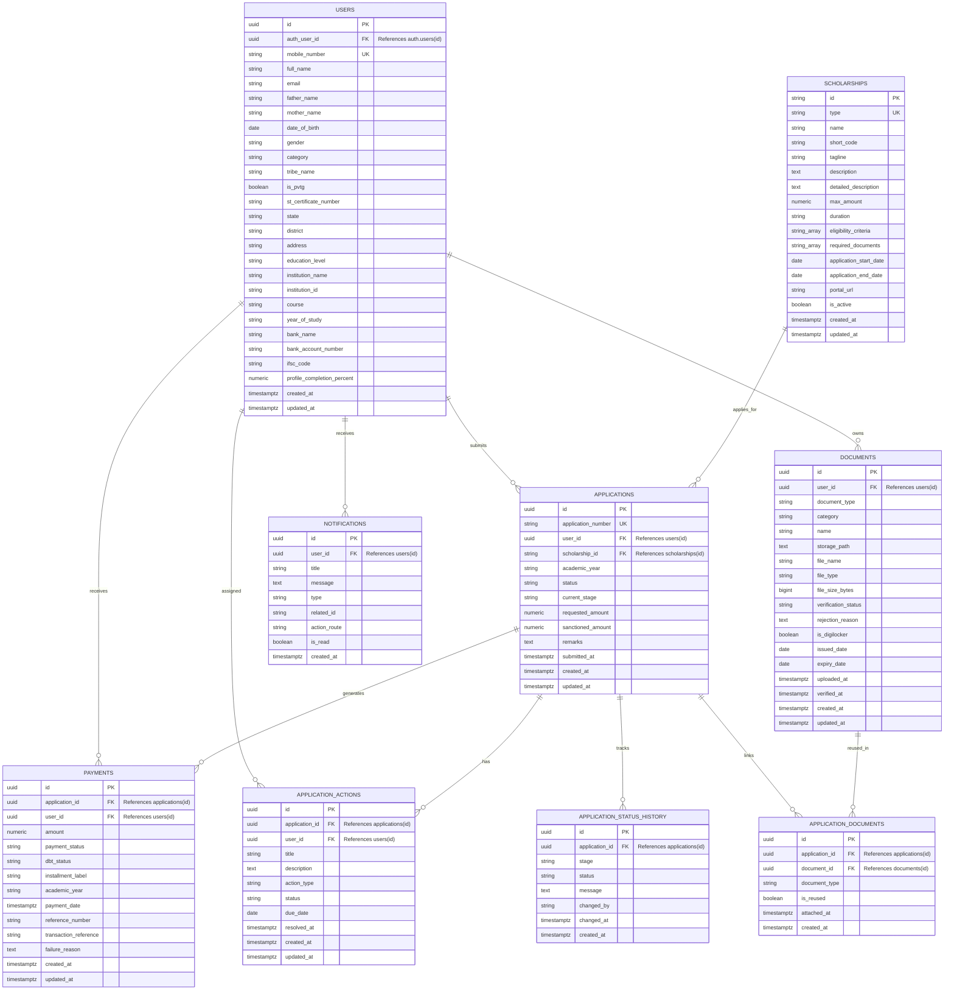

# MoTA Scholarship Mobile Application — Database & Backend Architecture

This document specifies the complete backend and data architecture for the **Tribal Scholar Saathi** mobile application developed for the Ministry of Tribal Affairs (MoTA) scholarship schemes.

---

## 1. Architectural Strategy & Target Backend

The application is architected around:
**Supabase Auth + PostgreSQL + Supabase Storage + Row Level Security (RLS)**

This choice provides:
- Strongly typed relational integrity for complex scholarship workflows.
- Granular database-level authorization via PostgreSQL Row Level Security (RLS).
- Isolated object storage buckets with path-based policies.
- Clean decoupling between client state (Provider), data access (Repositories), and remote/local persistence.

For offline development, automated testing, and execution without immediate cloud credentials, the system incorporates an in-memory/local relational store (`RelationalDataStore`) and local secure storage service (`LocalDocumentStorageService`) that enforce the exact same foreign key constraints and user-isolation rules.

---

## 2. Entity-Relationship Diagram (ERD)



---

## 3. Tables & Models Specification

### 3.1 `users`
- **Purpose**: Stores student demographic, tribal, academic, and bank account details.
- **Identity Link**: Linked 1-to-1 with Supabase `auth.users(id)` through `auth_user_id`.
- **Key Fields**:
  - `mobile_number`: Verified mobile number from OTP authentication.
  - `is_pvtg`: Boolean flag indicating Particularly Vulnerable Tribal Group status.
  - `st_certificate_number`: Issued caste certificate registration number.
  - `profile_completion_percent`: Dynamically tracked percentage.

### 3.2 `scholarships`
- **Purpose**: Master table for the five centrally sponsored MoTA schemes:
  1. Pre-Matric Scholarship for ST Students (`sch-pre-matric`)
  2. Post-Matric Scholarship for ST Students (`sch-post-matric`)
  3. National Scholarship for Higher Education / Top Class (`sch-top-class`)
  4. National Fellowship for ST Students (`sch-nfst`)
  5. National Overseas Scholarship (`sch-nos`)
- **Access**: Read-only for authenticated students (`is_active = TRUE`).

### 3.3 `applications`
- **Purpose**: Lifecycle tracking of student scholarship applications.
- **Foreign Keys**: `user_id -> users(id)`, `scholarship_id -> scholarships(id)`.
- **Stages (`current_stage`)**:
  - `Application` -> `Document Verification` -> `Institute Verification` -> `Department Verification` -> `Sanction` -> `Disbursement`.
- **Statuses (`status`)**:
  - `Draft`, `Submitted`, `Under Review`, `Verified`, `Approved`, `Sanctioned`, `Disbursement Initiated`, `Disbursed`, `Rejected`, `Withdrawn`.

### 3.4 `application_status_history`
- **Purpose**: Immutable audit log of status and verification transitions.
- **Utility**: Powers the dynamic application tracking timeline on the tracking screen.
- **Fields**: `id`, `application_id`, `stage`, `status`, `message`, `changed_by`, `changed_at`.

### 3.5 `documents`
- **Purpose**: Student document wallet containing verified and uploaded certificates.
- **Security**: Private files stored under path `documents/{user_id}/{document_id}`.
- **Verification Status**: `Pending`, `Verified`, `Rejected`, `Expired`, `Action Required`.

### 3.6 `application_documents` (Junction Table for Document Reuse)
- **Purpose**: Solves Part 9 (Document Reuse). Associates existing verified documents from the student's wallet to new scholarship applications without requiring duplicate uploads.
- **Fields**: `id`, `application_id`, `document_id`, `document_type`, `is_reused`, `attached_at`.

### 3.7 `application_actions` (Deficiencies & Pending Actions)
- **Purpose**: Tracks queries and deficiencies raised by verifiers or institutes (e.g., outdated income certificate, mismatched bank details).
- **Statuses**: `Open`, `In Progress`, `Resolved`, `Dismissed`.
- **Dashboard Integration**: Displayed in the Dashboard Action Required banner until resolved.

### 3.8 `payments`
- **Purpose**: Records PFMS Direct Benefit Transfer (DBT) disbursements.
- **States**: `Sanctioned` -> `Payment Processing` -> `Payment Processed` -> `DBT Initiated` -> `Credited` (or `Failed`).
- **Audit**: Tracks PFMS reference numbers and bank UTRs without fabricating live government transaction codes.

### 3.9 `notifications`
- **Purpose**: Real-time student alerts for status updates, payment credits, and deficiency requests.
- **Behavior**: Unread count directly powers the Dashboard notification badge.

---

## 4. Authentication Mapping

```
Mobile Number (e.g. +91 98765 43210)
    ↓
Send OTP (via SMS Gateway or Dev Sandbox)
    ↓
Verify 6-Digit OTP (Rate-limited, expiring, cryptographic)
    ↓
Supabase Auth Session / JWT Token (`auth.users.id`)
    ↓
Look up / Auto-provision `public.users` record (`WHERE auth_user_id = auth.uid()`)
    ↓
Populate `AuthProvider.currentUser` & Bind `ScholarshipDataService.switchUser(userId)`
```

---

## 5. Authorization & Row Level Security (RLS)

All student tables have Row Level Security enabled in PostgreSQL:
1. **Student Records (`users`)**:
   `USING (auth.uid() = auth_user_id)`
2. **Applications (`applications`)**:
   `USING (user_id IN (SELECT id FROM public.users WHERE auth_user_id = auth.uid()))`
3. **Documents (`documents`)**:
   `USING (user_id IN (SELECT id FROM public.users WHERE auth_user_id = auth.uid()))`
4. **Payments (`payments`)**:
   `USING (user_id IN (SELECT id FROM public.users WHERE auth_user_id = auth.uid()))`
5. **Notifications (`notifications`)**:
   `USING (user_id IN (SELECT id FROM public.users WHERE auth_user_id = auth.uid()))`
6. **Application Status History & Application Documents**:
   Accessible only if the parent application belongs to the authenticated user.

**Proof of Isolation**: User A (`auth.uid() = 'user_a'`) cannot query, update, or delete any row whose `user_id` belongs to User B (`'user_b'`).

---

## 6. Document Storage & Privacy

- **Bucket**: `documents` (Private, non-public bucket).
- **Path Template**: `documents/{user_id}/{document_id}_{filename}`.
- **Access Rule**:
  `USING (bucket_id = 'documents' AND (storage.foldername(name))[1] = auth.uid()::text)`.
- **Download / Viewing**: Client requests short-lived signed URLs (`expiresIn = 60 minutes`) via `DocumentStorageService`. Public file scraping is prohibited.

---

## 7. External Integrations Matrix

| System | Role | Current Status | Service Interface |
|---|---|---|---|
| **DigiLocker** | Aadhaar, Marksheets, Domicile import | Integration-Ready (Mock Adapter) | `DigiLockerService` |
| **UIDAI** | Aadhaar Demographic & e-KYC Verification | Integration-Ready (Simulated Sandbox) | `UIDAIService` |
| **State e-District** | Caste (ST) & Revenue Income certificate check | Integration-Ready (Mock Adapter) | `StateEDistrictService` |
| **NSP (National Scholarship Portal)** | Centrally sponsored PMS / Top Class portal sync | Integration-Ready (Stub Boundary) | `NSPService` |
| **SFMP (Tribal Fellowship Portal)** | NFST M.Phil/Ph.D fellowship management | Integration-Ready (Stub Boundary) | `SFMPService` |
| **NOS Portal** | Overseas candidate visa & university clearance | Integration-Ready (Stub Boundary) | `NOSService` |

*Note: All simulated endpoints clearly return `IntegrationStatus.readyForCredentials` or `IntegrationStatus.mockDemo` to prevent confusing mock responses with live government records.*
